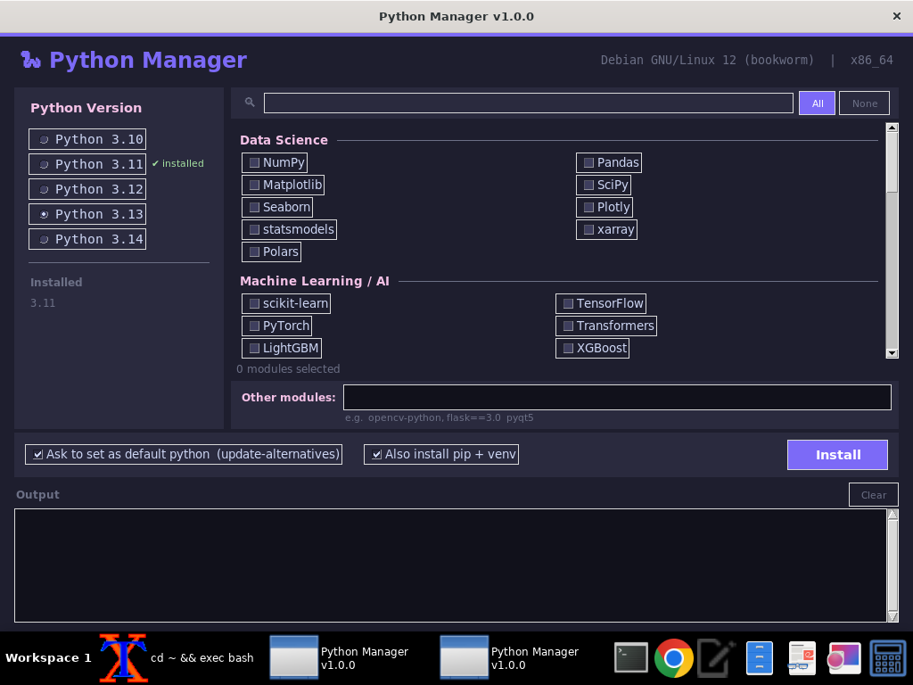

# Python Manager

A graphical Python version and module installer for Linux (x86-64 and ARM).


## Features

- **Select Python version** to install (3.10 – 3.14)
- **Browse & search a curated module list** across 7 categories: Data Science, ML/AI, Web, Database, Utilities, IoT/Hardware, Data Formats
- **One-click install** — adds the deadsnakes PPA on Ubuntu, runs `apt-get`, bootstraps pip
- **Set as default** — registers the installed version with `update-alternatives` so `python` and `python3` point to it
- **Live output log** — streams every command's output directly in the UI
- **Dark theme** — easy on the eyes

## Screenshot



## Install (prebuilt binary)

Download from the [Releases](https://github.com/itsnavin/python_manager/releases) page.

| Architecture | File |
|---|---|
| x86-64 PC | `python_manager-1.0.2-linux-x86_64.tar.gz` |
| Raspberry Pi / ARM | build on the Pi (see [ARM](#arm-raspberry-pi)) or run from source |

```bash
wget https://github.com/itsnavin/python_manager/releases/download/v1.0.2/python_manager-1.0.2-linux-x86_64.tar.gz
wget https://github.com/itsnavin/python_manager/releases/download/v1.0.2/python_manager-1.0.2-linux-x86_64.tar.gz.sha256
sha256sum -c python_manager-1.0.2-linux-x86_64.tar.gz.sha256
tar xzf python_manager-1.0.2-linux-x86_64.tar.gz
./python_manager-1.0.2-linux-x86_64/python_manager
```

> **Note:** The binary is self-contained but it still needs `python3-tk`'s runtime libraries on the host.
> On Debian/Ubuntu: `sudo apt install python3-tk`

## Run from source (recommended for development)

```bash
# Install dependencies
sudo apt install python3 python3-tk

# Run
python3 python_manager.py
```

## Where things get installed

| What | Where | Runs as |
|---|---|---|
| Python itself (apt / deadsnakes PPA) | `/usr/bin/pythonX.Y` | root (sudo) |
| `update-alternatives` links | `/usr/bin/python`, `/usr/bin/python3` | root (sudo) |
| pip + selected modules | `~/.local/lib/pythonX.Y/site-packages`, scripts in `~/.local/bin` | **your user** |

pip never runs as root, so it can't leave root-owned files that later cause
"Permission denied". If an older version of this app left root-owned files in
`~/.cache/pip` or `~/.local`, the app changes their owner back to you automatically.

> Don't start the app with `sudo`. Run it as your normal user; it asks for
> your sudo password only for the apt and update-alternatives steps.
> If you see `Permission denied` when *launching* it, the execute bit was lost
> (common after copying through Windows): `chmod +x python_manager`.

## Build a standalone binary

Build on the target machine (you cannot cross-compile tkinter apps with PyInstaller):

```bash
make install-deps   # installs python3-tk, pip, pyinstaller
make                # builds ./dist/python_manager
make dist           # packages into a .tar.gz with SHA-256 checksum
make install        # copies to /usr/local/bin
```

### ARM (Raspberry Pi)

```bash
# On the Pi:
git clone https://github.com/itsnavin/python_manager
cd python_manager
make install-deps && make dist
```

## Supported systems

| System | Python install method |
|---|---|
| Ubuntu (any version) | deadsnakes PPA via `apt` |
| Raspberry Pi OS (Debian) | direct `apt` |
| Other Debian-based | direct `apt` |
| Other Linux | pyenv (must be installed separately) |

## Modules catalogue

| Category | Included packages |
|---|---|
| Data Science | numpy, pandas, matplotlib, scipy, seaborn, plotly, statsmodels, xarray, polars |
| Machine Learning / AI | scikit-learn, tensorflow, torch, transformers, lightgbm, xgboost, catboost, onnx |
| Web / HTTP | requests, httpx, aiohttp, flask, django, fastapi, uvicorn, beautifulsoup4, scrapy |
| Database | sqlalchemy, pymysql, psycopg2, pymongo, redis, motor, alembic |
| Utilities | pillow, python-dotenv, pydantic, click, rich, loguru, pytest, black, flake8, tqdm |
| IoT / Hardware | RPi.GPIO, gpiozero, smbus2, pyserial, spidev, pigpio, adafruit-blinka |
| Data Formats | openpyxl, pyyaml, lxml, jsonschema, toml, arrow, msgpack |

## License

MIT
